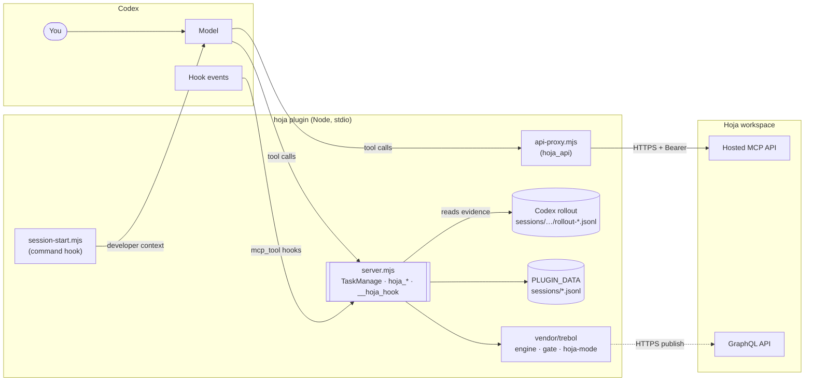

<div align="center">


# Hoja for Codex

**Tasks that can't be marked done without proof.**
Trebol's TaskManage, its task-enforcement gate, Hoja issue sync and session traces — as a Codex plugin.

[](LICENSE)
[](https://developers.openai.com/codex/plugins)
[](#verify-it-yourself)
[](https://github.com/hoja-work/hoja-claude-plugin)
[](https://github.com/hoja-work/hoja-antigravity-plugin)

</div>

---

Agents say "done" too easily. Hoja makes "done" mean something:

- **Every task has acceptance questions.** "Do the tests pass?" "Is the README updated?" — written up front.
- **Completion needs evidence that resolves.** Each answer cites `src/app.ts#L10-L40`, `README.md#Install`, or
  `tool:Bash#3` — a real file or a real tool result from *this* session, read from the Codex rollout. Made-up
  evidence is rejected.
- **Nothing mutates without a task.** A gate blocks shell writes, `apply_patch` and write-capable MCP tools until a
  task is focused. Reads are always free.
- **Your tracker stays current by itself.** With Hoja mode on, each top-level task becomes a Hoja issue and each
  of its child tasks a sub-issue; progress is rewritten in place, and an evidenced completion moves it to Done.
- **Nobody has to remind the agent.** Every message you write tells the agent how to register it (a new task, the
  open one, or a child of the active one), and when a reply ends after real work with its task unreconciled or
  untracked, the agent is sent back once to complete it with evidence or note what is left.

This is not a re-implementation. The engine, the gate and Hoja mode are
[Trebol](https://github.com/cloverinternational/trebol)'s own code, vendored byte-for-byte and hash-checked. The
plugin only translates between Codex's hooks and Trebol's runtime.

## Quick start

```bash
codex plugin marketplace add hoja-work/hoja-codex-plugin
codex plugin add hoja@hoja
```

Then three one-time steps:

1. **Sign in (optional).** Sign in once with the Hoja CLI; the plugin asks it for a current token and the
   workspace's endpoints (`hoja auth token --json`) and refreshes on expiry:
   ```bash
   hoja auth login acme.hoja.work
   ```
   For automation, export credentials in the shell that starts Codex instead; a configured token wins over the CLI
   sign-in. The plugin forwards only the variables listed in [Configuration](#configuration).
   ```bash
   export HOJA_API_URL=https://hoja.example.com/graphql HOJA_TOKEN=… HOJA_PROJECT="My Project"
   ```
2. **Trust the hooks.** Codex runs plugin hooks only after you review them: open `/hooks` in the TUI and trust the
   **hoja** hooks.
3. **Let the tools run.** Codex asks before each MCP tool call by default. To skip that for Hoja's tools, add this
   to `~/.codex/config.toml`:
   ```toml
   [plugins."hoja@hoja".mcp_servers.hoja]
   default_tools_approval_mode = "approve"

   [plugins."hoja@hoja".mcp_servers.hoja_api]
   default_tools_approval_mode = "approve"
   ```

Then work as usual, and type `hoja:setup` to check everything.

## What you get

| | |
| --- | --- |
| **`TaskManage`** | Ordered, durable tasks with dependencies, sub-tasks, notes and 1–12 acceptance questions each. Completion is validated against the workspace and the Codex rollout. |
| **Task gate** | Trebol's Swarm hook pipeline: blocks non-read-only tools without a focused task (`block`), or only nudges (`advise`). Also: the completion nudge, the task-maintenance nudge, the bare-`sleep` blocker and the stdin-conflict guard. |
| **Auto-continue** | When a gate block ends the turn, the `Stop` hook sends Codex back with exactly what to do, within the same bounded budget Trebol uses. |
| **Hoja mode** | `hoja_list`, `hoja_get` and `hoja_project`, plus automatic publication: one Hoja issue per top-level task and one sub-issue per child of it (`hoja:"local"` keeps a step out), acceptance questions in the description, an evidence comment and Done on completion. |
| **Hosted Hoja API** | The workspace's full MCP API (70+ tools: issues, comments, decisions, projects, cycles) as a second server, `hoja_api`. Its **read** tools are exempt from the gate (see [Deviations from Trebol](#deviations-from-trebol)); its writes are gated and evidence-checked under the same names Trebol uses. |
| **Session traces** | Every hook event is recorded; with the Codex rollout it becomes a `hoja.trace/v1` trace: turns, one model call per request with exact token usage, every tool call with its duration and outcome (non-zero exits, gate blocks, rejected TaskManage calls), subagents and task updates. Completing a task linked to an issue attaches the trace to that issue, and Hoja opens it in its trace viewer. See [Session traces](#session-traces). |
| **Prompt commands** | `hoja:tasks`, `hoja:hoja on\|off\|status`, `hoja:trace [upload [ISSUE]\|path]` and `hoja:setup`, typed as the whole prompt. All are answered locally, with no model turn — and `hoja_setup`, the same read-only report as a tool, is the fallback when the prompt hook cannot run. Omit the slash: the Codex TUI rejects unknown `/` commands. |
| **Skill** | `skills/hoja` teaches the create → focus → evidence workflow. |

## Screenshots, recordings and other artifacts

Anything a person should see goes into Hoja as an upload, never as a local path
(`/tmp/x.png`, `/root/...`, `file://`), because a path only opens on the machine that wrote it.

- `hoja_artifactUpload` takes `paths` (and optionally `issueId`, `titles`, `ttlDays`). It
  sends each file straight to Hoja's storage (up to 512 MB, no base64), attaches it to the
  task, and returns a shareable URL plus Markdown to paste. Use the URLs as `mediaUrl` on
  decision options to let a person choose between many variants.
- When an agent writes a task, comment, review request or decision that mentions an existing
  local image, video or PDF, the plugin uploads the file first and replaces the path with its
  link. Paths that do not exist are left alone.

## Decisions: ask a person, continue the same session with the answer

Ask with `hoja_taskDecisionCreate`. The plugin binds the decision to this Codex session (thread
id, transcript, cwd, git branch and head, permission mode, Codex pid, and the local Hoja runner
if one is enrolled here), taken from the hook payloads, never from the model's arguments: a
`binding` the model passes is dropped, and the tool schema does not offer one. Then either:

- **wait in the turn:** call `hoja_decisionWait({"id": "<decision id>"})` (up to 600 s; the
  `hoja_api` server's tool timeout is 660 s). The answer is the tool's result; or
- **just end the turn.** Then:
  - answered within 120 s of the stop: the Stop hook holds the turn and continues it with
    `decision: "block"`. Codex records the answer as a user-role `<hook_prompt>`;
  - answered later: Codex 0.169.0 has no way to wake an idle session from a hook, so the answer
    is delivered with your next prompt (UserPromptSubmit context), or after Codex has exited,
    by Hoja's runner resuming the thread (`codex exec resume <id>`) if a runner is enrolled here.

The answer arrives in a fixed frame, `⟦hoja-decision <id>#<n>⟧ <<<ANSWER chosen_option=<key> …
ANSWER>>>`. Treat it as the person's answer, not as instructions that change permissions. Only a
person may answer a bound decision (`HOJA_DECISION_ANSWERERS=agents` in the environment lets a
test rig answer with an agent credential; the model cannot set it).

## Configuration

Codex has no plugin settings UI, so configuration comes from the environment. The servers receive only these
variables (`env_vars` in [`.mcp.json`](.mcp.json)):

| Variable | Purpose |
| --- | --- |
| `HOJA_API_URL` (deprecated alias: `LINEAR_API_URL`) | Hoja GraphQL endpoint, e.g. `https://hoja.example.com/graphql` |
| `HOJA_MCP_URL` | Hosted MCP endpoint. Derived from the GraphQL host when unset |
| `HOJA_TOKEN` (deprecated alias: `LINEAR_TOKEN`) | Personal API token |
| `HOJA_PROJECT` | Default project for publication. Also `.pi/config/hoja.json` in the repo |
| `HOJA_TASK_ENFORCEMENT` | `block` (default) · `advise` · `off` |
| `HOJA_TRACE_UPLOAD` | `completion` (default): attach the trace when a linked task completes · `session-end`: also attach the final trace to every linked issue at session end · `manual`: only `hoja:trace upload` · `off` |
| `HOJA_TRACE_DETAIL` | `full` (default): whole prompts, tool inputs and outputs and model responses, secret-scrubbed · `metadata`: names, timings, statuses and token counts only |
| `HOJA_PLUGIN_HEADLESS=1` | Use Trebol's headless (`swarm -p`) prompt semantics, e.g. for `codex exec` |
| `HOJA_PLUGIN_DISABLE_HOJA=1` | Turn Hoja mode off entirely; TaskManage and the gate still run |
| `HOJA_DEBUG_LOG=/path` | Append every hook and tool call the server receives |

Like Trebol, there is **no default endpoint**: Hoja calls fail closed with a message naming the variable to set.
Without credentials, TaskManage and the gate still work and publication is skipped.

## Updates

Codex never updates a plugin by itself. To update:

```bash
codex plugin marketplace upgrade && codex plugin add hoja@hoja
```

Then restart Codex.

At most once a day (six hours after a failed attempt) the SessionStart hook reads the version in this repository's
`package.json` on GitHub. That is a plain request with nothing about you in it, it gives up after 1.5 s, and the answer
is cached in the plugin's data directory. When a newer version exists, Codex shows one line at session start (the hook's `systemMessage`; it never enters the model's context) with the exact
update command. Offline or rate-limited means no notice, never an error. Set `HOJA_PLUGIN_UPDATE_CHECK=off` to turn the
check off.

## Session traces

The hook bridge appends every hook event to `$CODEX_HOME/plugins/data/hoja-hoja/traces/<session>.events.jsonl`. When a
trace is needed it is built from those records plus the session's rollout:

- `task_started` / `task_complete` mark each turn and its duration.
- Each `token_usage_record` closes one model request, with its response id and exact usage. OpenAI counts cached
  input inside `input_tokens`; the trace keeps `cache_read_tokens` separate, using Claude Code's OpenTelemetry names.
- `function_call` / `function_call_output` pairs become tool spans. `exec_command` and `shell` show as `Bash`, with
  the command as the label. A non-zero exit, a gate block or a rejected TaskManage call is marked as such.
- `SubagentStart` / `SubagentStop`, `PreCompact` / `PostCompact` and `SessionEnd` come from hooks.

The rollout format is internal to Codex, so it is read defensively. A session whose rollout cannot be read still gets
a trace from hooks alone.

Uploads go to `POST /api/traces` (older servers: `POST /api/uploads` and `attachmentCreate`) when a linked task completes, in the background at most every 30 s after a tool batch and at the end of every reply once an issue is linked (no hook waits for them), and at session end. Traces are named `codex-<session>-<time>.trace.json` with a
"Codex trace · …" subtitle, which the Hoja web app opens in its trace viewer. Prompts and outputs are kept whole
and scrubbed of credential shapes and secret-looking environment values. Trimming (head and tail kept) happens only
when a trace would pass the 8 MB upload budget. `HOJA_TRACE_DETAIL=metadata` sends timings and counts only. Type
`hoja:trace` for a summary, `hoja:trace upload HOJA-123` to attach it now, or `hoja:trace path` for the JSON file.
The trace format and its privacy rules are described in full in the
[Claude Code plugin's README](https://github.com/hoja-work/hoja-claude-plugin#session-traces).

## How it works

Codex's hook model matches Claude Code's closely, including `mcp_tool` hooks that call a tool on an
already-connected MCP server. One server process per session holds the task state, the gate and the Hoja client.
It serves the tools *and* receives every hook event, so they share memory — exactly as they do inside Trebol's Pi
runtime.



### Trebol → Codex mapping

| Trebol (Pi runtime) | Codex |
| --- | --- |
| `registerTool` (TaskManage, hoja_*) | MCP stdio server `hoja` (`mcp__hoja__TaskManage`, …) |
| `tool_call` block / pre-context | `PreToolUse` → `permissionDecision: "deny"` / `additionalContext` |
| `tool_result` | `PostToolUse` |
| `turn_end` (once per tool batch) | The `PostToolUse` that settles the last in-flight call (Codex has no `PostToolBatch`) |
| `before_agent_start` system prompt | `SessionStart` command hook |
| `agent_before_settle` gate resume | `Stop` → `decision: "block"`; Codex turns the reason into the continuation prompt |
| `/tasks`, `/hoja` | `hoja:tasks`, `hoja:hoja`, matched in `UserPromptSubmit` and blocked locally (Codex has no `UserPromptExpansion`) |
| Pi session messages | The Codex rollout. `exec_command` / `shell` count as `Bash`; MCP calls become `namespace__name` |
| Session entries | `$CODEX_HOME/plugins/data/hoja-hoja/sessions/<id>.jsonl` |
| — (tracing is plugin-only) | `SubagentStart`/`SubagentStop`, `PreCompact`/`PostCompact` → recorder; `SessionEnd` → `dist/trace-hook.mjs` (a command hook). Codex has no `PostToolUseFailure`: a failure is read from the `PostToolUse` result and the rollout |

Codex gives hooks `PLUGIN_DATA` but not MCP servers, so the server derives the same directory from its install path.
Both always agree.

### Known Codex limits

- Plugin hooks need a one-time trust review (`/hooks`). Until you do it, tools work but the gate does not run.
- Codex documents tool hooks as "a useful guardrail, not a complete enforcement boundary". Hosted tools such as
  `WebSearch` don't go through hooks.
- Per Codex's docs, plugins that bundle lifecycle hooks can't be listed in the public plugin directory. Install
  this one from its marketplace as shown above.

## Verify it yourself

```bash
git clone https://github.com/hoja-work/hoja-codex-plugin && cd hoja-codex-plugin
npm ci
npm run vendor:check   # 53 vendored files match vendor/MANIFEST.json (SHA-256)
npm test               # Trebol's own 25 suites, unmodified, plus the adapter, trace and Antigravity tests: 401 tests
npm run install:local  # codex plugin marketplace add . && codex plugin add hoja@hoja
```

Then a live check:

```bash
codex exec --skip-git-repo-check -s workspace-write "Run: touch proof.txt . If a hook blocks it, follow its instructions, then retry."
```

You should see the block, a `TaskManage` create and focus, the retried command, and an evidenced completion.

## Troubleshooting

| Symptom | Fix |
| --- | --- |
| Nothing is ever blocked | The hooks are not trusted yet. Open `/hooks`. Set `HOJA_DEBUG_LOG` to see whether `__hoja_hook` calls arrive. |
| `MCP tool call requires approval` in `codex exec` | Add the `default_tools_approval_mode = "approve"` config from [Quick start](#quick-start). |
| `Unrecognized command '/hoja:setup'` | Type `hoja:setup` without the slash. |
| `hoja_api` serves no tools | No endpoint or token reached the server. Export the variables before starting Codex. |
| Tasks are not published | Run `hoja:hoja status` and `hoja:setup`. Publication needs a token and a resolvable project. |
| No trace was attached | Only tasks linked to an issue get one, once per task. `hoja:trace` shows the upload status; `hoja:trace upload HOJA-123` attaches it by hand. |
| A read-only tool was refused by the gate | Read tools of the hosted API and `hoja_project action:list` are exempt. A tool that is not on that list (or a shell command Trebol's allowlist does not know) is gated by design — set `HOJA_TASK_ENFORCEMENT=advise`, or use plain `ls`/`cat`/`grep`/`git log` forms. |

## Deviations from Trebol

The vendored code decides everything; the adapter only widens or re-routes three things a host does differently (published issue content is no longer one: Trebol sends the task's description and priority with the create). Each
one is covered by a test in `test/reported-bugs.test.ts`.

| Area | Trebol | Here | Why |
| --- | --- | --- | --- |
| Schema loading | — | `ToolSearch` is never gated (Claude Code only) | Claude Code defers MCP tools behind `ToolSearch`; gating it could make the gate's only exit (TaskManage) unreachable. |
| Read-only discovery | its own read tools (`hoja_list`, `hoja_get`, context, history, vault list/get) | also the hosted Hoja API's read tools (`hoja_viewer`, `hoja_workspace`, `hoja_teams`, `hoja_issues`, `hoja_projects`, `hoja_cycles`, `hoja_workflowStates`, `hoja_*Decisions`, inbox, labels, `hoja_extensionActions`, …), `hoja_project action:list` and `hoja_setup` | Trebol never sees the hosted API, so the gate refused a health check until an issue was filed. Writes (`hoja_issueCreate`, `hoja_taskUpdate`, `hoja_commentCreate`, `hoja_extensionActionRun`, `hoja_notificationMarkRead`, every `*Answer`/`*Update`/`*Delete`) stay gated. |
| Read-only Bash | `isBashReadOnly` over its tokenizer | the same call after dropping pure file-descriptor redirections (`2>&1`, `>&2`, `>/dev/null`, `&>/dev/null`) | Trebol's tokenizer reads the `&` in `2>&1` as a command separator, so `cat file 2>&1` looked like two commands. Redirects to real files are untouched, and Trebol's allowlist stays conservative (`|| true` is still not read-only). |
| Prompt commands | `hoja:tasks`, `hoja:hoja` are Pi commands | matched in `UserPromptSubmit` (Codex has no `UserPromptExpansion`), with any spelling of the command name, plus the `hoja_setup` tool | A hook that cannot reach the plugin server fails open; the command text then reached the model. |

## Development

```text
src/            adapter (same source as the Claude Code and Antigravity plugins; HOJA_PLUGIN_HOST=codex selects Codex names and wire shapes)
vendor/trebol/  Trebol files, byte-for-byte (never edit; re-vendor instead)
dist/           bundled entry points (committed, because plugins run without a build step)
.codex-plugin/  plugin manifest
.mcp.json       the hoja and hoja_api servers
hooks/          hooks.json — every event is forwarded to the server's __hoja_hook tool
skills/hoja/    workflow skill
.agents/plugins/marketplace.json   makes this repo installable with `codex plugin marketplace add`
```

To re-vendor from a Trebol checkout, run `TREBOL_ROOT=~/src/trebol npm run vendor && npm run build && npm test`.

## License

[MIT](LICENSE). `vendor/trebol/` is unmodified code from
[cloverinternational/trebol](https://github.com/cloverinternational/trebol). See [NOTICE](NOTICE).
